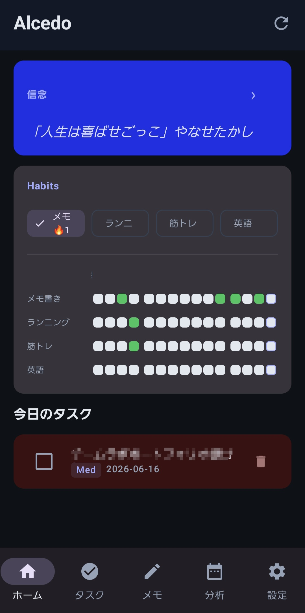
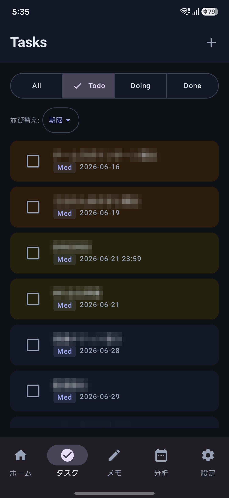

## 概要

自分専用の生活管理アプリです．タスク・習慣・信念の管理に加えて，PC とスマホで何にどれだけ時間を使ったかを自動で記録し，グラフで振り返れます．
Android アプリと PC 向けの Web アプリがあり，どちらからでも同じデータを扱えます．

- 制作期間：2026/04-（使いながら改良中）
- 担当範囲：企画・設計・実装・運用（個人開発）
- 主要技術：Kotlin（Jetpack Compose），React，TypeScript，Fastify，SQLite，C#（.NET 8），Docker

## 開発の思い・背景

ToDoリストや習慣化アプリは毎日使うものなので，小さなストレスでも積み重なると大きな認知負荷になります．
そこで，タスク・習慣・信念の管理と，自分の時間の使い方の記録を1か所にまとめた，自分専用の「パーソナル・オペレーティング・システム」を作ることにしました．

## 画面

## 機能

### 信念・習慣・タスク

- **信念**：自分が大切にしている言葉を登録しておくと，ホーム画面の一番上にランダムで1つ表示されます．毎日アプリを開くたびに目に入るようにしました．
- **習慣トラッカー**：ランニング・筋トレ・英語などの習慣を，ワンタップで記録できます．連続日数（ストリーク）と，過去60日分の達成状況をヒートマップで確認できます．
- **タスク管理**：
  - Todo / Doing / Done の状態と優先度で絞り込み，期限や優先度で並べ替えられます．
  - 期限までの日数でカードの色が変わるので（今日は赤，3日以内は橙，7日以内は黄），急ぐものがひと目でわかります．
  - タスクの中にサブタスクを何段でも入れられます．
  - 期限の時刻を設定すると，その少し前に通知します．Android ではアラームのように鳴らし，ロック画面の上に全画面で知らせることもできます．
- **メモ**：チャットのような画面で，思いついたことをすぐに書き留められます．他のアプリの「共有」からURLを送ると，記事のタイトル付きのカードとして保存されます．

### 時間の使い方の記録と分析

- **PC の作業記録**：Windows に常駐する自作アプリが，今使っているアプリやブラウザのタブのタイトルを記録します．3分以上操作がなく動画なども再生していない間は，作業していないものとして記録しません．
- **スマホの使用時間**：Android のアプリ使用時間を自動で集計して，サーバーに送ります．
- **分析画面**：PC とスマホの記録を合わせて，1日の時間の使い方を24時間のタイムラインと円グラフで表示します．
  - アプリやサイトは，自分で決めたルールでカテゴリ（研究・SNS など）に分けます．
  - カテゴリごとに目標時間を決めて，達成率を確認できます．
  - 複数の端末を同時に使っていた時間が二重に数えられないようにしています．

## 製作

### 構成

| 部分 | 技術 |
|------|------|
| Android アプリ | Kotlin，Jetpack Compose，Room，WorkManager，Hilt |
| Web アプリ | React，TypeScript，Vite，Recharts |
| サーバー | Node.js（Fastify），SQLite |
| PC の作業記録アプリ | C#（.NET 8，Windows Forms） |
| 公開 | Docker Compose，Cloudflare Tunnel |
| 開発 | Claude Code |

サーバーは自宅のサーバーで Docker で動かし，Cloudflare Tunnel 経由で外出先のスマホからもつながるようにしています．
Web アプリには，データが変わるとサーバーから通知が届き（SSE），他の端末で変更した内容がすぐに反映されます．

### こだわり

- **すべてを1つのアプリに**：タスク，習慣，メモ，時間の記録をそれぞれ別のアプリで管理すると，アプリを行き来するだけで疲れてしまいます．毎日使うものだからこそ，1か所で済むようにしました．
- **信念を一番上に**：タスクや習慣は，こなすこと自体が目的になりがちです．アプリを開くたびに自分の信念が目に入るようにして，何のためにやっているのかに立ち返れるようにしました．
- **記録は自動で**：時間の使い方を手で記録するのは続きません．PC とスマホが勝手に記録してくれるので，意識しなくても自分の実際の過ごし方が見えるようにしました．
- **自分で作る**：市販のアプリは，どこかが自分の使い方に合いません．自分で作れば，使っていて気になったところをその日のうちに直せます．

## 今後の展望

- Android のホーム画面ウィジェットで，信念と習慣を常に目に入るようにする
- メモを Obsidian（自分のメモ帳）に自動で送る
- Google カレンダー・Google マップの履歴・Home Assistant（在宅や消灯の検知）と連携して，睡眠時間なども記録する

## 関連リンク

- [GitHub リポジトリ（wakky-alcedo/alcedo-personal-app）](https://github.com/wakky-alcedo/alcedo-personal-app/tree/dev)
