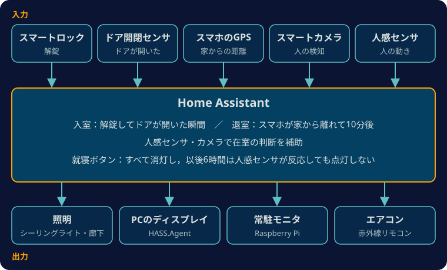
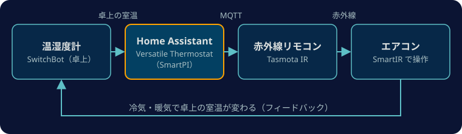
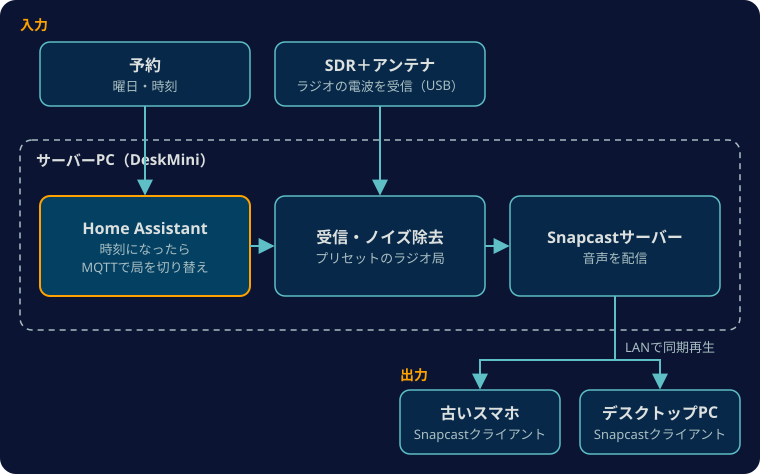
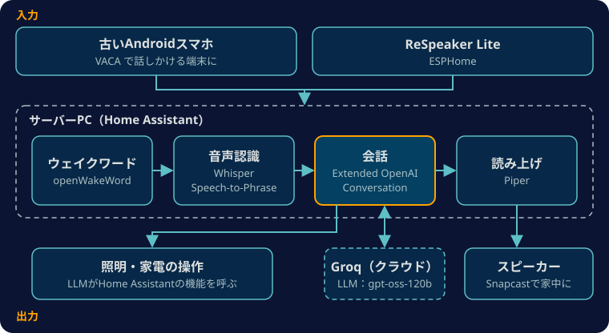

## 概要
我が家（といっても一人暮らし賃貸ですが）では，怠惰な私が楽をするためにあらゆるデバイスがインターネットに繋がっています．
引っ越したての2024頃はAlexaを使っていたのですが，徐々に条件分岐などかゆいところに手が届かなくなり，[Home Assistant](https://www.home-assistant.io)を導入することにしました．Home Assistantは，オープンソースのスマートホームプラットフォームです．

- 制作期間：2026/02/04～現在
## 開発の思いor背景・課題
Alexaの問題点として例えば，
- 外出時は自動的に消灯してほしいが，家にいるのにずっと動かずにPCに向かって作業をしていると勝手に消灯されて困る
- SwitchBot，tapo，Sesamiなど複数メーカーのIoTデバイスを使いたいが，それぞれにハブ端末が必要で出費がかさむ
- 夏，昼間は30℃設定でも26℃まで下がるのに，夕方をすぎると30℃設定のままだと31℃くらいで灼熱
などがありました．

そこで，メーカーを問わずすべての機器を直接ハブPCに繋げ，細かい条件分岐などにも対応させようと構築したのが，本Home Assistantです．
## 製作
### 環境

| 項目 | 内容 |
| --- | --- |
| サーバー | DeskMini A300 上の Proxmox VM に Home Assistant OS をインストール |
| 外部からのアクセス | Cloudflare Tunnel（ルーターのポートを開けずに，外出先からも使える） |
| 規模 | 統合 56 ／ デバイス 91 ／ エンティティ 534 ／ 自動化 25（2026年11月時点） |

用途ごとのデバイス

- **照明・電源**：tapo，SwitchBot，Tuya の照明・スマートプラグ
- **空調**：赤外線リモコン（Tasmota IR を MQTT 経由で操作）でエアコン・扇風機を操作
- **防犯・在室の検知**：セサミ5（スマートロック），Reolink のカメラ（人物検知），ミリ波レーダー（LD2410），ドアセンサ，スマホの位置（Companion アプリ）
- **音声アシスタント**：古い Android スマホ，ReSpeaker Lite（ESPHome）
- **音響**：Snapcast（家中のスピーカーで同時再生），Spotify
- **趣味・サーバー**：3D プリンタ（Bambu Lab A1 mini），NAS，SDR（ラジオや航空無線，アマチュア無線を受信してPCにデジタル信号として伝える機器）
- **その他**：壁掛けのダッシュボード（Raspberry Pi 4B＋タッチパネル），NFC タグ（「いってきます」「おやすみ」）

## 主な機能
### 人の出入りに基づく，照明・家電の点灯・消灯の自動化
- 入力：スマホの位置，カメラの人物検知，ドアセンサ，スマートロックの解錠，ミリ波センサ，NFC タグ
- 出力：照明，エアコン，PC のディスプレイ

家にいるかどうかを「外出フラグ」として持ち，それに合わせて照明・エアコン・PC のディスプレイをオンオフしています．
Alexa のときに困っていた「家にいるのに，PC に向かってじっとしていると消灯される」を防ぐため，センサーが反応しないだけでは消さず，外出フラグが立っているときだけ消すようにしました．

外出扱いにする条件は次のとおりです．

- スマホが10分続けて外出，かつ人物・ドアの動きが10分なし（GPS が数分だけ外へ飛んでも反応しない）
- ドアが閉まって60分，その間に人物・ドアの動きなし（お客さんが帰ったあとの消し忘れを防ぐ）
- 「いってきます」の NFC タグをタッチ

在宅扱いに戻す条件は次のとおりです．帰ってきたときはすぐ点けたいので，スマホの位置は待たずに反応します．

- 中に動きがない状態でドアが開き，10秒以内に解錠
- カメラが人物を検知
- スマホが3分続けて在宅

玄関のミリ波センサは誤検知が多いので，在宅扱いのときの点灯にだけ使っています．
また，寝るとき（おやすみ）はすべて消灯し，以後6時間はセンサーが反応しても照明をつけないようにしています．

この判定は，実際の10日分の履歴で再現して検証し，見つかった不具合を3つ直しました．

### 外部の温度計フィードバックによる，エアコンの設定温度の自動調整
- 入力：温湿度計
- 出力：エアコン（赤外線リモコン）

先述の通り，夏場は，昼間は30℃設定でも26℃まで下がるのに，夕方をすぎると30℃設定のままだと31℃くらいで灼熱になるということがありました．
そこで，エアコンとは別に，SwitchBotの温湿度計を卓上に設置し，それを元にエアコンの設定温度を調整するシステムを作りました．
設定温度の計算には Versatile Thermostat（SmartPI）を使い，計算した設定温度は MQTT で Tasmota の赤外線リモコンに送ってエアコンに伝えています．

### 予約したラジオ番組の時間に基づく，ラジオの自動オンオフ
- 入力：予約した曜日・時刻，SDR（Software-Defined Radio）
- 出力：Snapcastで接続したスピーカー（古いスマホ，PCのスピーカーなど）

SDRをHAが稼働するPCに接続して，ラジオの電波を拾います．受信周波数はいくつかのラジオ局をプリセットとして登録し，MQTT で局を切り替えられるようにしました．これにより，決まった曜日・時刻になると，Home Assistant が局を選んで自動でラジオが付きます．
そして，拾った音声は，ノイズ除去などを施して，Snapcastで接続したスピーカーから再生します．
Snapcastとは，「複数の部屋や端末で音声を同期再生するためのオープンソースのクライアント・サーバー型オーディオプレーヤー」です．
SnapcastサーバーをサーバーPCに立て，古いスマホやデスクトップPCにクライアントソフトを入れることで，複数端末からの同時再生を実現しています．

### 音声アシスタント「シリウス」
- 入力：古い Android スマホ，ReSpeaker Lite のマイク
- 出力：Snapcast のスピーカー，照明・家電の操作

Alexa の代わりに，自分の音声アシスタント「シリウス」を作りました．
話しかける端末は，古い Android スマホ（VACA）と ReSpeaker Lite（ESPHome）です．
ウェイクワードの検出（openWakeWord），音声認識（Whisper ／ Speech-to-Phrase），読み上げ（Piper）は家のサーバーで動かし，会話を考える部分だけクラウドの LLM（Groq の gpt-oss-120b）に任せています．
LLM は Home Assistant の機能を呼び出せるので，話しかけるだけで照明や家電を操作できます．返事は Snapcast 経由で家中のスピーカーから読み上げます．

### その他の自動化
- 声でセットする目覚まし（音・照明・音量を少しずつ上げて起こす）
- 窓開けのリマインド
- 赤外線での扇風機の操作
- タイマー終了のアナウンス

## 運用
設定の変更は Claude Code に手伝ってもらっています．ただし，ずっと動き続ける AI は置かず，メンテナンスのときだけ私が立ち会って動かしています．
詳しくは別のブログ記事で紹介する予定です．

## 今後の課題or今後の展望
- スマートカーテンの製作・設置
- 使われなくなった（unavailable の）エンティティが約80個残っているので片付ける
- Snapcast で読み上げを鳴らす部分を，ffmpeg 8 で動くように手で書き換えたままなので，きちんと整える

## 関連リンク
- Home Assistant公式サイト：https://www.home-assistant.io

## 画像の出典

- タイトル画像：Home Assistant 公式サイトの共有用画像（[default-social.png](https://www.home-assistant.io/images/default-social.png)）を，改変せずに使用しています．出典：[home-assistant/home-assistant.io](https://github.com/home-assistant/home-assistant.io)，ライセンス：[CC BY-NC-SA 4.0](https://creativecommons.org/licenses/by-nc-sa/4.0/deed.ja)．「Home Assistant」の名称とロゴは Open Home Foundation の商標です．
- 本記事は個人が Home Assistant を使った事例の紹介であり，Home Assistant および Open Home Foundation の公式・公認のものではありません．
