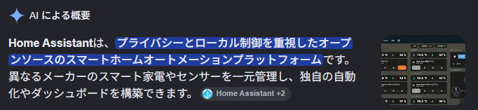

## 概要
我が家（といっても一人暮らし賃貸ですが）では，怠惰な私が楽をするためにあらゆるデバイスがインターネットに繋がっています．
引っ越したての2024頃はAlexaを使っていたのですが，徐々に条件分岐などかゆいところに手が届かなくなり，[Home Assistant](https://www.home-assistant.io)を導入することにしました．Home Assistantは，オープンソースのスマートホームプラットフォームです．

- 制作期間：2026/02/04～現在
## 開発の思いor背景・課題
Alexaの問題点として例えば，
- 外出時は自動的に消灯してほしいが，家にいるのにずっと動かずにPCに向かって作業をしていると勝手に消灯されて困る
- SwitchBot，tapo，Sesamiなど複数メーカーのIoTデバイスを使いたいが，それぞれにハブ端末が必要で出費がかさむ
- 夏，昼間は30℃設定でも26℃まで下がるのに，夕方をすぎると30℃設定のままだと31℃くらいで灼熱
などがありました．

そこで，メーカーを問わずすべての機器を直接ハブPCに繋げ，細かい条件分岐などにも対応させようと構築したのが，本Home Assistantです．
## 製作
### 環境
- **サーバー**：DeskMini-A300上のProxmox VMとして，Home Assistant OSをインストール．独自ドメインで外出先からもアクセス可能．
- **接続IoTデバイス**：
  - スマートディスプレイ：RaspberryPi 4B＋タッチパネル，ブラウザでダッシュボードを表示）
  - シーリングライト（tapo）
  - 廊下用電球（tapo）
  - セサミ スマートロック（CANDY HOUSE）
  - 温湿度計×2（SwitchBot）
  - ドア開閉センサ（SwitchBot）
  - スマートカメラ（Reolink）
  - デスクトップPC（HASS.Agentで接続）
  - スマートプラグ（tapo）（3Dプリンタを接続）
  - SDR（ラジオや航空無線，アマチュア無線を受信してPCにデジタル信号として伝える機器）
  - 随時追加予定
## 主な機能
### 人の出入りに基づく，照明の点灯・消灯の自動化
- 入力：スマートロックの解錠信号，スマホのGPS，スマートカメラおよび人感センサ
- 出力：照明，ディスプレイ（デスクトップPCおよびHome Assistant常駐モニタ），エアコン（赤外線リモコン）

すべての照明とディスプレイの点灯・消灯をコントロールしています．
人の出入りの検知について

- 入ったことは，すぐ反応するため，解錠してドアを開けた瞬間
- 出たことは，誤検知を防ぐため，メインスマホのGPSが家から離れて10分後

としています．
他にも人感センサを使い，判断のアシストをしています．
また，人がいても消灯したいタイミング（就寝時）には，以後6時間は人感センサが反応しても照明をつけない機能があります．
### 外部の温度計フィードバックによる，エアコンの設定温度の自動調整
- 入力：温湿度計
- 出力：エアコン（赤外線リモコン）

先述の通り，夏場は，昼間は30℃設定でも26℃まで下がるのに，夕方をすぎると30℃設定のままだと31℃くらいで灼熱になるということがありました．
そこで，エアコンとは別に，SwitchBotの温湿度計を卓上に設置し，それを元にエアコンの設定温度を調整するシステムを作りました．
### 予約したラジオ番組の時間に基づく，ラジオの自動オンオフ
- 入力：予約した時間，SDR（Software-Defined Radio）
- 出力：Snapcastで接続したスピーカー（古いスマホ，PCのスピーカーなど）

SDRとは，ラジオや航空無線，アマチュア無線を受信してPCにデジタル信号として伝える機器です．
これをHAが稼働するPCに接続して，ラジオの電波を拾います．受信周波数はいくつかのラジオ局をプリセットとして登録しました．これにより予約した時間に自動でラジオが付きます．
そして，拾った音声は，ノイズ除去などを施して，Snapcastで接続したスピーカーから再生します．
Snapcastとは，「複数の部屋や端末で音声を同期再生するためのオープンソースのクライアント・サーバー型オーディオプレーヤー」です．
SnapcastサーバーをサーバーPCに立て，古いスマホやデスクトップPCにクライアントソフトを入れることで，複数端末からの同時再生を実現しています．
## 今後の課題or今後の展望
- スマートカーテンの製作・設置

を行う予定です．
## 関連リンク
- Home Assistant公式サイト：https://www.home-assistant.io

## 画像の出典

- タイトル画像：Home Assistant 公式サイトの共有用画像（[default-social.png](https://www.home-assistant.io/images/default-social.png)）を，改変せずに使用しています．出典：[home-assistant/home-assistant.io](https://github.com/home-assistant/home-assistant.io)，ライセンス：[CC BY-NC-SA 4.0](https://creativecommons.org/licenses/by-nc-sa/4.0/deed.ja)．「Home Assistant」の名称とロゴは Open Home Foundation の商標です．
- 本記事は個人が Home Assistant を使った事例の紹介であり，Home Assistant および Open Home Foundation の公式・公認のものではありません．
