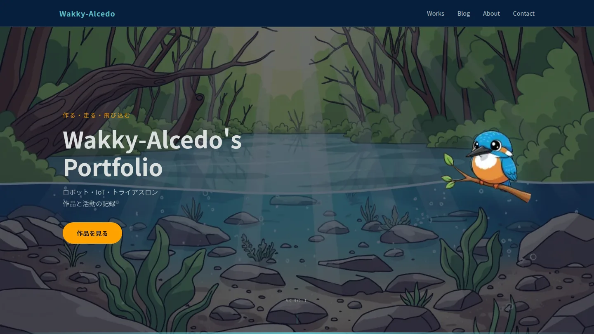
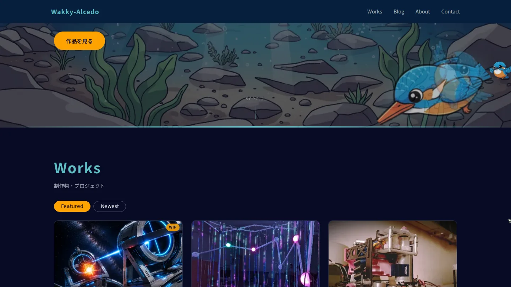
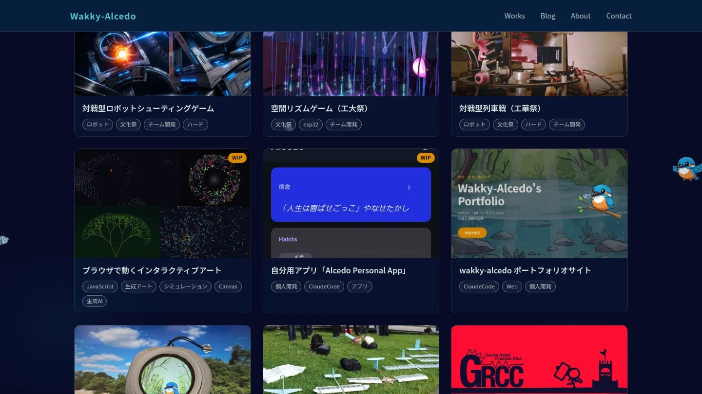
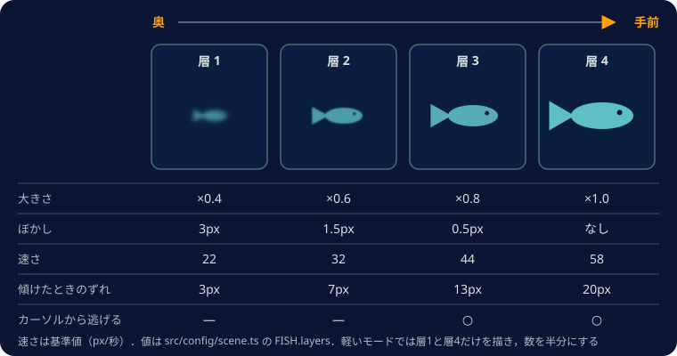
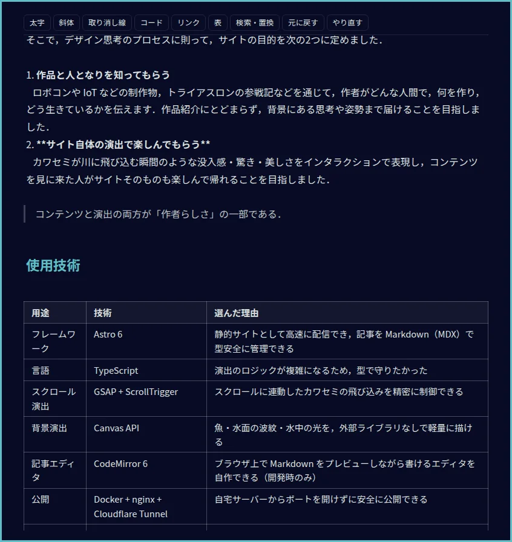
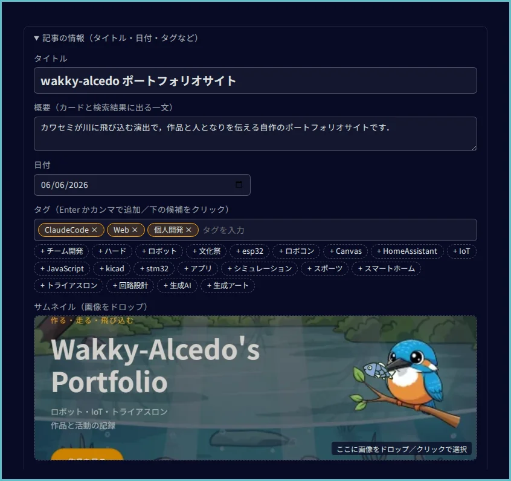
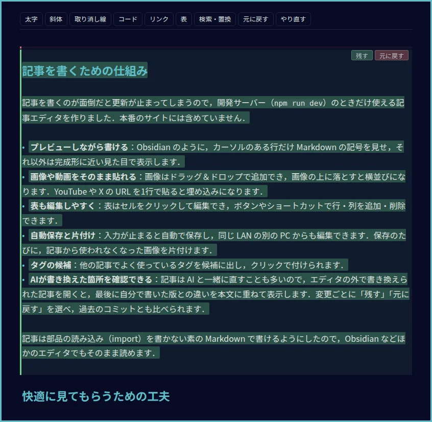
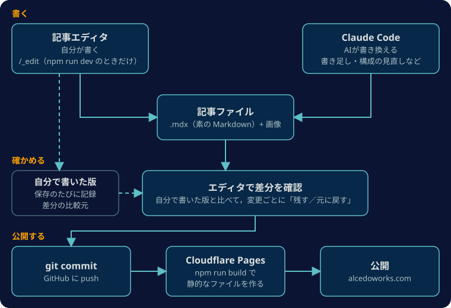
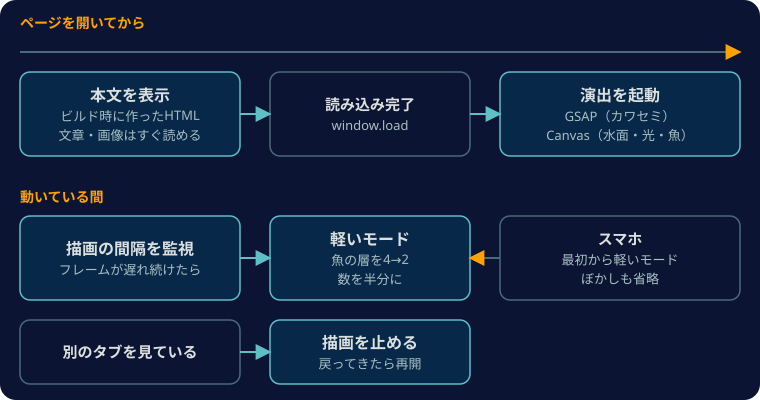

## 概要

今ご覧いただいているこのサイトです．作品や活動をまとめるためのポートフォリオサイトを，Claude Code と一緒に一から作りました．

- 制作期間：2026/06-（運用しながら改良中）
- 担当範囲：企画・デザイン・実装・運用（個人開発）
- 主要技術：Astro，TypeScript，GSAP，Canvas API，CodeMirror 6，Cloudflare Pages

## 開発の思い・背景

Claude Code を使うようになって，自分用のホームページも作れるのではないかと考えました．そして，ホームページ制作を通じて，AIとの協業の勘所を掴みたいと思い，このプロジェクトを始めました．
また，作品や活動をまとめておく場所が欲しかったというのもあります．

そこで，デザイン思考のプロセスに則って，サイトの目的を次の2つに定めました．

1. **作品と人となりを知ってもらう**
   ロボコンや IoT などの制作物，トライアスロンの参戦記などを通じて，作者がどんな人間で，何を作り，どう生きているかを伝えます．作品紹介にとどまらず，背景にある思考や姿勢まで届けることを目指しました．
2. **サイト自体の演出で楽しんでもらう**
   カワセミが川に飛び込む瞬間のような没入感・驚き・美しさをインタラクションで表現し，コンテンツを見に来た人がサイトそのものも楽しんで帰れることを目指しました．

> コンテンツと演出の両方が「作者らしさ」の一部である．

## 使用技術

| 用途 | 技術 | 選んだ理由 |
|------|------|------------|
| フレームワーク | Astro 6 | 静的サイトとして高速に配信でき，記事を Markdown（MDX）で型安全に管理できる |
| 言語 | TypeScript | 演出のロジックが複雑になるため，型で守りたかった |
| スクロール演出 | GSAP + ScrollTrigger | スクロールに連動したカワセミの飛び込みを精密に制御できる |
| 背景演出 | Canvas API | 魚・水面の波紋・水中の光を，外部ライブラリなしで軽量に描ける |
| 記事エディタ | CodeMirror 6 | ブラウザ上で Markdown をプレビューしながら書けるエディタを自作できる（開発時のみ） |
| 公開 | Cloudflare Pages | ビルドした静的なファイルをそのまま配信でき，GitHub に push すれば公開まで自動で進む |
| 開発 | Claude Code | 仕様書を書き，AIと一緒に実装・レビュー・リファクタリングを回した |

## こだわったポイント

トップページは，最初の画面を止まり木のある**水上**，下にスクロールした先（Works・Blog・About が並ぶところ）を**水中**に見立てています．

### 水上（ヒーロー）

- **カワセミの飛び込み**：下にスクロールすると，止まり木のカワセミが川へ飛び込み，水面に大きな波紋が広がります．スクロール量に連動しているので，ゆっくり動かすと一連の動きをコマ送りのように見られます．
- **放置すると漁をする**：しばらく放置すると，カワセミが水面へ飛び込んで戻ってきます．ときどき魚をくわえて帰ってきます．

### 水中（コンテンツ）

- **泳ぐ魚**：魚の群れは Boids アルゴリズム（分離・整列・結合の3ルール）で動いています．奥から手前まで4層に分かれていて，奥ほど小さく，ぼやけて，ゆっくり見えるようにして奥行きを出しました．
- **逃げる魚（隠し要素）**：カーソルを近づけたりクリックしたりすると，手前の魚が驚いて逃げます．
- **スマホを傾けると立体的に**：フッターのスイッチを入れてスマホを傾けると，魚の層が少しずつずれて，水槽をのぞき込んでいるような奥行きが出ます．
- **水中の光**：水面から差し込む光の揺らめき（コースティクス）を描いています．
- **スクロールバー役のカワセミ**：水中では右端のカワセミがスクロールに合わせて上下します．クリックすると魚を捕まえて水上へ飛び出し，最初の画面に戻ります．
- **作品へ飛ぶときの演出**：Works のカードをクリックすると，カワセミが餌を捕まえて飛び出す演出のあとに作品ページへ移動します．

魚の4つの層は，奥ほど小さく，ぼかしを強く，ゆっくりにしています．

### 記事ページ

- 記事中の画像はクリックすると拡大表示でき，クリックするたびに 1倍 → 2倍 → 4倍とズームします．ズーム中はドラッグで見たい場所へ動かせます．

### 配色

カワセミと水辺から，紺（背景）・青緑（見出しなど）・オレンジ（ボタンなどのアクセント）の配色にしました．デザインをやっている友人に提案してもらったパレットをもとに，**紺 70：青緑 25：オレンジ 5** を目安に役割を決め，青を使いすぎないようにしています．

## 記事を書くための仕組み

記事を書くのが面倒だと更新が止まってしまうので，開発サーバー（`npm run dev`）のときだけ使える記事エディタを作りました．本番のサイトには含めていません．

- **プレビューしながら書ける**：Obsidian のように，カーソルのある行だけ Markdown の記号を見せ，それ以外は完成形に近い見た目で表示します．
- **画像や動画をそのまま貼れる**：画像はドラッグ＆ドロップで追加でき，画像の上に落とすと横並びになります．YouTube や X の URL を1行で貼ると埋め込みになります．
- **表も編集しやすく**：表はセルをクリックして編集でき，ボタンやショートカットで行・列を追加・削除できます．
- **自動保存と片付け**：入力が止まると自動で保存し，同じ LAN の別の PC からも編集できます．保存のたびに，記事から使われなくなった画像を片付けます．
- **タグの候補**：他の記事でよく使っているタグを候補に出し，クリックで付けられます．
- **AIが書き換えた箇所を確認できる**：記事は AI と一緒に直すことも多いので，エディタの外で書き換えられた記事を開くと，最後に自分で書いた版との違いを本文に重ねて表示します．変更ごとに「残す」「元に戻す」を選べ，過去のコミットとも比べられます．

記事は部品の読み込み（import）を書かない素の Markdown で書けるようにしたので，Obsidian などほかのエディタでもそのまま読めます．

自分が書いた内容と AI が書き換えた内容を見分けて取り込めるように，記事を書いて公開するまでの流れを次のようにしています．

## 快適に見てもらうための工夫

演出を盛り込むほど，端末によっては重くなります．演出で読みにくくなっては本末転倒なので，次の工夫を入れました．

- **本文を先に表示**：文章や画像はビルド時に HTML として用意し，演出のスクリプトはページの読み込みが終わってから動かします．
- **重さに合わせて自動で軽く**：描画が追いつかない端末では，魚の数や水中の光の数を自動で減らします．スマホは最初から軽いモードで動かします．
- **見ていないときは止める**：別のタブに切り替えたときは，アニメーションの計算を止めてバッテリーを節約します．
- **動きを減らす設定に対応**：OS で「視差効果を減らす」を設定している人には，アニメーションを止めた静かな画面を表示します．
- **傾きセンサーは許可制**：iPhone では傾きの取得にユーザーの許可が必要です．ページを開いた瞬間に確認ダイアログを出すのは不親切なので，フッターのスイッチを押したときにだけ許可を求めます．
- **印刷にも対応**：ダーク基調のまま印刷するとインクを大量に使うので，フッターで「節約（白基調）」と「そのまま」を切り替えられるようにしました．全作品をまとめて PDF に書き出すスクリプトも用意しています．
- **検索や SNS で見つけてもらう**：サイトマップと robots.txt を出力し，記事ごとに OGP（SNS で共有したときのタイトルや画像）と構造化データを設定して，検索エンジンや SNS に内容が正しく伝わるようにしました．

## AIとの協業で学んだこと

### 2026/06/06 時点

使用したAI：Claude Sonnet 4.6
コーディングは得意ですが，デザイン，特にアニメーションは難しいと感じました．普通のサイトにはないアニメーションを作ろうとすると，実装が難しいのではないかと考えています．

### 2026/11/20 時点

使用したAI：Claude Opus 5.5
プログラムのリファクタリングを行い，主に重複したコードを整理しました．
カワセミのアニメーションも修正しつつありますが，まだ完全ではありません．やはり，まだまだアニメーションは難しそうです．あ，新規で作り直したらうまくいく可能性もありそう？
さらに，SEO対策を行いました．一言ですべてやってくれたので，AIの進化を感じました．

## 今後の展望

- 時間帯や季節によって，水上と水中の色や背景が変わる演出
- 英語版のページ
- カードにカーソルを合わせると，写真が切り替わったり動画が再生されたりする演出

## 関連リンク

- [GitHub リポジトリ（wakky-alcedo/wakky-alcedo-portfolio）](https://github.com/wakky-alcedo/wakky-alcedo-portfolio)
