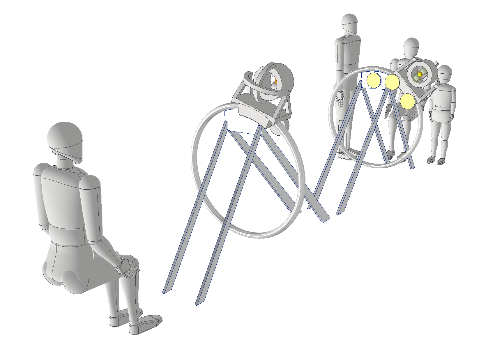

## 概要

自分のロボットを操作して，相手のロボットのHPを削り合う，対戦型のロボットシューティングゲームです．
プレイヤーは，レール上を走るロボットを操縦します．移動して相手の弾をかわしながら砲身の向きを変え，ピンポン玉を発射して，相手ロボットの「的」を狙います．的に当たるとHPが減り，制限時間内により多く相手のHPを削った方の勝ちです．
目の前で動く実物のロボットの迫力を，親子や友達と一緒に体験できます．

作品の紹介は，ランディングページ「[*ArTe | 対戦型ロボットシューティングゲーム](https://arte.alcedoworks.com/robot-shooting/)」もご覧ください．

https://youtu.be/37fScKyArFs

- 制作期間：2026/05-（展示しながら改良中）
- チーム：ものづくり団体 *ArTe の3人（東京科学大学2人，筑波大学1人）
- 担当範囲：全体統括，回路・制御，ランディングページの実装（AIを活用．デザインはあかりんが担当）

## 開発の思い

高専時代から，文化祭などで「自分たちで作ったもので子どもたちが遊んでくれる」場をつくってきました．赤外線銃や，[射的ロボット](/works/2023-shooting-game)もその一つです．お客さんの歓声を直接聞けるのが嬉しくて，ものづくりを続けています．
昨年は[空間リズムゲーム](/works/2025-3d-rhythm-game)を作りました．学生でいられる期間も残り2年を切ったので，好きなものづくりに全力で取り組んでおきたいと思い，今年の企画を始めました．

テーマを決めるために，まずメンバーで「小さい頃に楽しかったものは何か」を洗い出しました．出てきたのは，鉄砲，長い棒，そして対戦です．そこから，次の2つを軸に決めました．

- **子どもが自分で動かせること**：年齢ごとに同時に操作できる数（自由度）の限界を調べ，子どもでも扱える操作系にしました．
- **親や友達と一緒に遊べること**：空間リズムゲームから一貫して大切にしているコンセプトです．

## こだわり

- **実物が目の前で動く**：デジタルゲームに慣れた子どもたちに，実機ならではの迫力を体験してもらうことを何より大切にしました．
- **AIで開発時間を短縮し，その分を体験づくりに**：制御基板やソフトの開発に生成AIを活用し，浮いた時間で，的やLEDディスプレイの演出，戦闘機を参考にした操縦桿など，遊ぶ人の体験を磨きました．

## 製作

機械担当（いっそー），回路・制御担当（私），企画・デザイン担当（あかりん）の3人で製作しました．私はプロジェクト全体の統括も担当しました．

### 機械

弾倉から射出ローラまでの装填・発射機構を，1つの機体に高密度に収めています．クランク機構とラックアンドピニオンの倍ストロークを組み合わせ，モータ1回転で1発分の装填を行います．

### 回路・制御（担当）

- **制御基板**：STM32 と ESP32-C6 を載せた基板を設計しました．モータ5系統・エンコーダ5系統と CAN 通信を扱えます．非常停止は，マイコン・基板上のスイッチ・外部スイッチの3つがすべて許可したときだけ動く構成にして，安全を確保しています．
- **操縦桿**：戦闘機の操縦桿を参考に，右手のレバーで砲身の向き，左手のレバーで移動，トリガーで発射する形にしました．
- **ゲームの進行**：ゲーム開始・一時停止・リセットを操作するゲームマネージャ画面を作り，LEDディスプレイに残り時間・HP・残弾数を表示し，効果音も鳴らします．

{/* TODO: 機体・操縦桿・制御基板・LEDディスプレイの写真 */}

## 成果・実績

一般の来場者に遊んでもらいながら，展示のたびに改良を続けています．

| イベント | 日程 | 体験者数 |
|----------|------|----------|
| 東京科学大学 工大祭2026 | 2026/10/10-11 | 42人 |
| 東京科学大学 お茶の水祭 | 2026/10/17-18 | 146人 |
| としまっ子フェス2026 | 2026/11/01 | — |

最初の展示の工大祭では，1日目はロボットを動かせず，2日目から1台で運用を始めました．弾詰まり，ギヤのかみ合い外れ，モータのネジの緩みで何度も止まりましたが，部品の作り直しや調整を重ねて安定して動かせるようになりました．その後，自動装填を実現し，2台目を作って対戦型へと少しずつ完成させていきました．

## 振り返り

- **見積もりの甘さ**：研究や就職活動で進捗が遅れ，最初の展示に完成が間に合いませんでした．「このイベントに出るために作る」のではなく，「出来上がったから出そう」という順序にすべきだったと感じています．
- **見せ方が大事**：展示では実況が大きな盛り上がりを生みました．作ったものをどう見せるかも，作品の一部だと実感しました．
- **頼れる仲間**：高専時代からの仲間は「大丈夫か？」と何度も聞いてくれるので，できないことを正直に言いやすく，チームで助け合いながら進められました．

## 今後の展望

- 子どもたちから要望の多かった，砲身の上下（仰角）の操作に対応する
- 体験者へのアンケートをもとに改良し，さらに多くのイベントに出展する

## 関連リンク

- ランディングページ：[*ArTe | 対戦型ロボットシューティングゲーム](https://arte.alcedoworks.com/robot-shooting/)
- 公式Instagram：[*ArTe @arte.festalab](https://www.instagram.com/arte.festalab)
- GitHub Organization：[arte-studio](https://github.com/arte-studio)
